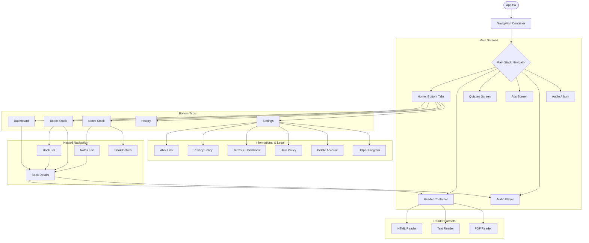

# ShweYwethla App Architecture & Documentation

This document provides a comprehensive overview of the ShweYwethla application, including its navigation structure, technology stack, and data management workflows.

## 1. App Overview
ShweYwethla is a React Native mobile application designed for reading books, short notes, and listening to audiobooks. It features a rich dashboard, categorical browsing, and multiple reader formats (PDF, Text, HTML).

## 2. Technology Stack & Services

### **Frontend Mobile**
- **Framework:** React Native (TypeScript)
- **Navigation:** React Navigation (`@react-navigation/native`, `@react-navigation/native-stack`, `@react-navigation/bottom-tabs`)
- **Styling:** React Native Stylesheets & `react-native-linear-gradient`
- **Ads:** `react-native-google-mobile-ads` (AdMob)
- **Utilities:** `react-native-splash-screen`, `react-native-safe-area-context`, `react-native-reanimated-carousel`

### **Data Fetching & API**
- **Firebase Firestore:** Primary database for Books, Notes, Categories, and Search Keywords.
- **Firebase Realtime Database:** Used for dynamic Dashboard Carousel (Ads) content.
- **Axios:** Handles REST API calls for specialized features (Base URL: `https://d17qwwj2uuuc4d.cloudfront.net/`).
- **TanStack Query (@react-query):** Manages server-state, caching, and background synchronization.
- **CloudFront:** Used as a CDN for the custom API backend.

### **Data Storage & Persistence**
- **AsyncStorage:** The primary local storage for:
  - User Authentication Tokens (`@token`)
  - Downloaded Book Metadata (`@DownloadedBooks`)
  - App Configuration & Cache Persistence.
- **React Query Persister:** `createAsyncStoragePersister` is used to persist Query results into `AsyncStorage` for offline access.
- **Firebase Storage:** Stores media assets like book covers and carousel images.

### **State Management**
- **DashboardContext:** A custom Context Provider that caches Firestore/Realtime DB data globally to prevent redundant network calls across the app.
- **Jotai / Recoil:** Used for lightweight global states like user session and authentication.

## 3. Navigation Structure (Diagram)

## 4. Page Count and Descriptions

The application consists of approximately **18 distinct screens**:

| # | Page Name | Description |
|---|-----------|-------------|
| 1 | **Dashboard** | Entry point with carousel (Realtime DB), categories, and trending lists (Firestore). |
| 2 | **Book List** | Displays books filtered by category from Firestore. |
| 3 | **Book Details** | Detailed metadata and action triggers (Read/Listen). |
| 4 | **Notes List** | Specialized for "Short Notes" (30-min reads). |
| 5 | **History** | Tracks user reading and manages downloaded files via AsyncStorage. |
| 6 | **Settings** | User preferences and app metadata. |
| 7 | **Reader (Container)** | Dynamic loader for PDF, Text, or HTML reader components. |
| 8 | **HTML Reader** | WebView for interactive HTML content. |
| 9 | **Text Reader** | Native text viewer. |
| 10 | **PDF Reader** | Specialized PDF viewer. |
| 11 | **Audio Player** | Audiobook playback interface. |
| 12 | **Audio Album** | Track listing for audiobooks. |
| 13 | **Quizzes** | Interactive quiz functionality. |
| 14 | **Ads** | Reward-based interstitial screen. |
| 15 | **Register** | User authentication and token management. |
| 16 | **About Us** | Application and mission info. |
| 17 | **Legal/Policy** | Privacy, Terms, and Data Policy screens. |
| 18 | **Account Delete** | User account deletion workflow. |

## 5. Core Workflows

### Data Fetching Flow
1. **Initial Mount**: `DashboardProvider` triggers `fetchAllData()`.
2. **Parallel Fetching**: Firestore (Books, Categories) and Realtime DB (Carousel) are queried simultaneously.
3. **Caching**: Data is stored in the `DashboardContext` state and persisted to `AsyncStorage` via TanStack Query.
4. **Offline Access**: If no network is available, the app loads the last cached state from `AsyncStorage`.

### Content Consumption Flow
1. **Download**: `downloadFile()` utility downloads book assets.
2. **Persistence**: `addDownloadedBook()` saves the local file path and book info to `AsyncStorage`.
3. **Reading**: `Reader.tsx` determines the file type and renders the appropriate native or WebView component.
